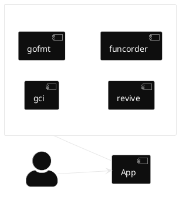

---
# try also 'default' to start simple
theme: seriph
# random image from a curated Unsplash collection by Anthony
# like them? see https://unsplash.com/collections/94734566/slidev
background: https://cover.sli.dev
# some information about your slides (markdown enabled)
title: Workshop Create Your First Linter
info: |
  ## Slidev Starter Template
  Create Your First Linter
# apply UnoCSS classes to the current slide
class: text-center
# https://sli.dev/features/drawing
drawings:
  persist: false
# slide transition: https://sli.dev/guide/animations.html#slide-transitions
transition: slide-left
# enable Comark Syntax: https://comark.dev/syntax/markdown
comark: true
# duration of the presentation
duration: 90min
hideInToc: true
---

# Create Your First Linter

Workshop (90min)

<div class="abs-br m-6 text-xl">
  <a href="https://github.com/manuelarte/workshop-create-your-first-linter" target="_blank" class="slidev-icon-btn">
    <carbon:logo-github />
  </a>
</div>

<!--
The last comment block of each slide will be treated as slide notes. It will be visible and editable in Presenter Mode along with the slide. [Read more in the docs](https://sli.dev/guide/syntax.html#notes)
-->

---
transition: fade-out
layout: statement
hideInToc: true
---

# What is a linter?

<div v-click class="bg-gray-100 dark:bg-gray-800 p-8 rounded-xl text-2xl shadow-lg mt-8">
  Automatically analyze source code for potential errors, 
  <span v-mark.circle.red="2">stylistic issues</span>, and violations of coding conventions
</div>

<!--
You can have `style` tag in markdown to override the style for the current page.
Learn more: https://sli.dev/features/slide-scope-style
-->

<style>
h1 {
  background-color: #2B90B6;
  background-image: linear-gradient(45deg, #4EC5D4 10%, #146b8c 20%);
  background-size: 100%;
  -webkit-background-clip: text;
  -moz-background-clip: text;
  -webkit-text-fill-color: transparent;
  -moz-text-fill-color: transparent;
}
</style>

<!--
Here is another comment.
-->

---
layout: image-right
image: /qr-github-manuelarte.jpeg
backgroundSize: 20em 60%
hideInToc: true
---

# About Me

```go [me.go] {2|all}
var Me = Developer{
	Name: "Manuel Doncel Martos",
	Skills: [][]string {
        {"☕Java", "Spring Boot"},
        {"🦫Go", "🐍Python"},
        {"Kubernetes", "Docker"},	
    },
    Interests: []string {
        "Open Source",
        "Domain Driven Design",
        "⚽Football",
    },
}
```

---
hideInToc: true
---

# Table of contents

<Toc text-sm minDepth="1" maxDepth="2" />

---
layout: statement
---

# Abstract Syntax Tree (AST)

Tree that represents the structure of a program or code snippet

---
level: 2
transition: slide-up
hideInToc: true
---

# AST Example

```plantuml
@startwbs
skinparam backgroundColor transparent
skinparam monochrome reverse
!option handwritten true

* ast.File
** ast.GenDecl
*** ast.ImportSpec
**** ast.BasicLit
** ast.GenDecl
*** ast.ValueSpec
**** ast.Ident
**** ast.BasicLit
** ast.GenDecl
*** ast.TypeSpec
*** ast.StructType
**** ast.FieldList
***** ast.Field
***** ast.Field
** ast.FuncDecl
*** ast.FuncType
*** ast.FieldList
**** ast.Field
**** ast.Field
** ...
@endwbs
```

<!-- Footer -->

<div class="absolute left-30px bottom-30px">
  <a target="_blank" href="https://github.com/manuelarte/workshop-create-your-first-linter/blob/main/astexample/testdata/src/simple/example.go">File to test</a>
</div>

---
transition: slide-up
---

# Tools Analyzer

Package [golang.org/x/tools](https://pkg.go.dev/golang.org/x/tools)

- Node: represents a node in the AST.
- Analyzer: (a.k.a. linter) analyzes the AST and reports issues.
- Pass: represents a single run of an Analyzer on a set of files.
- Diagnostic: represents an issue found by an Analyzer.

---
level: 2
layout: statement
transition: slide-up
hideInToc: true
---

# AST Exercise

---
layout: section
---

# My First Linter

---
layout: two-cols-header
level: 2
transition: slide-up
---

# Definition

## [Prefix unexported globals with '`_`' ](https://github.com/uber-go/guide/blob/master/style.md#prefix-unexported-globals-with-_)

<br>

Prefix unexported top-level vars and consts with _ to make it clear when they are used that they are global symbols.

::left::

❌ Bad

```go
const myConstant = "myConstant"
const errNotFound = "not found"
```

::right::

✅ Good

```go
const _myConstant = "myConstant"
const errNotFound = "not found"
```

<style>
.two-cols-header {
  column-gap: 20px;
}
</style>

---
level: 2
transition: slide-up
---

# Implementation

- Write test cases first. Using [analysistest](https://pkg.go.dev/golang.org/x/tools/go/analysis/analysistest).
- Implement business logic.

---
level: 2
hideInToc: true
---

# Let's


---
level: 2
layout: center
transition: slide-up
hideInToc: true
---

# Comments

- Stylistic linters are very useful in big projects or in big teams.
- Be consistent.

---
layout: center
---

# Run Linter

---
level: 2
transition: slide-up
---

# Standalone

<br>

```bash
go install ..../unexportedconstantscheck
cd myproject
unexportedconstantscheck --fix ./...
```

---
level: 2
layout: two-cols
transition: slide-up
hideInToc: true
---

# golangci-lint Plugin

<br>

[Golangci-lint](https://golangci-lint.run/) is a fast linters runner for Go.

* Widely used.
* More than 100 linters.
* Linters & Formatters.

::right::



<style>
    ul {
        font-size: 2em;
    }
</style>

---
level: 2
---

# golangci-lint Plugin

- Custom golangci-lint binary.
- Custom linter added to that binary.

<style>
    ul {
        font-size: 2em;
    }
</style>

---
level: 2
hideInToc: true
---

# Let's


---
layout: image
image: /q_a.png
backgroundSize: 100%
hideInToc: true
---

# Q/A
